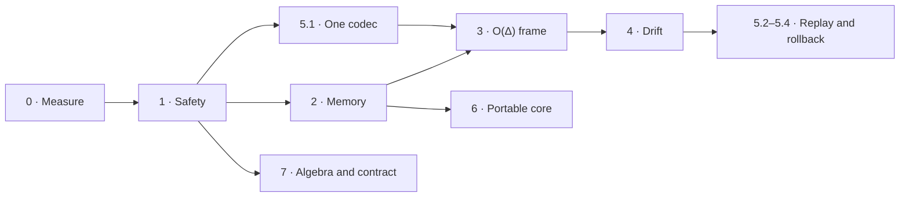

# sv Roadmap — 1M entities · 5 µs · 200 MB

> **Baseline:** `main@0c063b1` (atom 50) · Composition Contract v1.0.3 (v1.1.0 on bus 0036 and clause 18 still pending).
> **Method:** I only read `src/`, the README receipts and the vendored contract. Nothing was built, run or benchmarked to write this. Numbers are README receipts, byte arithmetic from the code, or labelled estimates. Every atom names the receipt that will confirm or kill it.
> **Rules kept:** atoms that touch the contract are **bus-first** (AGENTS.md). `contract/` and `tests/Sv.Tests/StrictFloatOracle.cs` are not touched. Production code stays comment-free, unmanaged, FMA-free and deterministic. Line references point at `main@0c063b1`.

How to read this:
- §0–2: why the target needs a different shape.
- §3: what is broken now.
- §4: the techniques.
- §5: the target system.
- §6: the laws that prove it.
- §7: the atoms.
- §8: what the bus must approve.
- §9: what gets deleted.
- §10: what stays impossible.

---

## 0 · Verdict

| | Today | Target |
|---|---|---|
| Frame, 1M entities | ≈ 10.6 ms (`frame-run` is 1,064.8 µs at 100k rows, and every stage scales with rows) | ≤ 5 µs as long as ≤ ~150 cold or ~350 warm entities change per frame |
| Memory, FF-1M workload (§2.2) | ≈ 0.9 GiB owned by sv | ≈ 150 MiB (≈ 157 MB) |
| Rollback | `SaveState` copies O(capacity × stats) | undo log, O(Δ): ~100 KiB for 8 frames |
| Determinism digest | per frame, O(live × stats) copy plus hash | O(Δ) |
| Reconcile | O(capacity × stats), then every live pair re-resolved (≈ 1 s at FF-1M) | O(moved rows) |

**No design can touch a million rows in five microseconds.** One dense read-modify-write pass over one 1M-row `int` column moves 8 MiB. On one core streaming from DRAM that takes roughly 200–800 µs, 40–160× the whole budget (§1). That leaves exactly one way to reach the goal: **sv's per-frame cost must depend only on what changed (Δ), never on how many entities exist (N).** Every cost that grows with N moves to one of two places:
- a structural boundary (spawn wave, bind, keyframe), where milliseconds are acceptable;
- the host's own dense kernels, which read sv's materialized columns at memory bandwidth on the host's budget.

Three properties already hidden in the code make an O(Δ) sv possible:

1. **Intrinsic updates form a monoid.** Atom 50 pinned `clamp(saturate(v + δ)) == clamp((long)v + δ)`. Maps of the form `x ↦ clamp(x + s, f, c)` compose in O(1), and their n-th power is also O(1). So *n frames of regen* is one evaluation, and it is bit-identical to n eager passes. Intrinsics stop being a per-frame pass. Each one becomes `(v₀, t₀, rule)` and is rebased only when the stats behind its rule change (§4.1).
2. **Sets are immutable values.** Atom 23 already uses this for joins. Taken all the way, it deletes the member arrays, member positions, pair queue and dirty-set queue (≈ 260–320 MiB at FF-1M). It also makes recompute run exactly once per pair, in topological order (§4.2–4.4).
3. **The board already knows what changed.** `changedTouched` has existed since atom 36, but callers only see it as dense words. Expose it, add one clock and a timing wheel, and compute the digest from key deltas. Then conditions, expiry, tape and rollback all become O(Δ) (§4.6–4.7).

---

## 1 · The physics of the budget

| Fact | Value | Consequence |
|---|---|---|
| One 1M-row `int` column | 4 MiB | a read-modify-write pass moves 8 MiB |
| Single-core DRAM streaming (estimate) | ~10–40 GB/s | ≈ 200–800 µs per dense column pass |
| `intrinsics-uniform` receipt | 33.4 µs per 100k rows, data in cache | ≥ 334 µs at 1M, even before data falls out of cache |
| DRAM miss | ~80–100 ns | 5 µs ≈ 50–60 misses that each wait on the previous one |
| Misses in flight per core | ~10–20 | independent misses, sorted and prefetched, cost ~5–10 ns per line on average |
| Cold lines per stat mutation today | ≈ 20 (page pointer, `PairMods`, modifier block, `PairMeta`, live word, bucket, five parallel set arrays, content, two member arrays, the moved member's meta, mirror, column, changed word) | ≈ 25 cold mutations per 5 µs |
| Cold lines per mutation, target | 2–4 | ≈ 150 cold or ≈ 350 warm mutations per 5 µs |
| Fork/join on a thread pool | microseconds | threads help bulk passes, not a 5 µs frame |

**Δ-budget model.** `frame ≈ c₀ + Σᵢ Δᵢ · linesᵢ · t_line`:
- `c₀ ≈ 0.2 µs` covers swap, wheel tick and digest fold;
- `t_line ≈ 10 ns` when the line is cold, ≈ 3–5 ns when warm.

Every atom in §7 either lowers some `linesᵢ` or deletes a term whose Δ is secretly N.

---

## 2 · Where time and bytes go today

### 2.1 Frame stages at one million

| Clause-7 step | Today | Cost at 1M | Target | How |
|---|---|---|---|---|
| input edges | O(button words) | ~10 ns | same | — |
| drain previous events | O(events), untyped `void*` dispatch per event | O(Δ) | O(Δ), typed batches, per-slot folding | §4.8 |
| host intrinsics pass (regen, re-clamp) | O(N) dense chunk per intrinsic | ≥ 334 µs per intrinsic | O(rebased rows) | §4.1 |
| modifier expiry | binary heap the host must call, O(k log n), not a declared step | O(Δ log n) | O(due) | §4.6 |
| stat recalc + broadcast | O(queued pairs); FIFO can visit a derived pair twice | O(Δ) | O(Δ), exactly once | §4.3 |
| tl Apply/Advance | clears the effect column and advances every clock | ≥ 4 MiB cleared per timeline | O(clip edges) | tl seam (bus) |
| condition run-walk | dense masks (`ChangedWords` is 16,384 words per stat) | several µs per stat or more | O(changed words) | §4.6 |
| write events + swap | O(writers) | ✓ | ✓ | — |
| tape | copies live rows × stats, then XXH64 | ≈ 0.7 ms at 1M × 3 stats | O(Δ) | §4.7 |
| reconcile (structural) | O(capacity × stats), then full re-resolve on the next recalc | ≈ 1 s at FF-1M | O(moved rows) | F16, §4.6 |

### 2.2 The memory bill

**FF-1M** is the workload this roadmap is measured against:
- 2²⁰ live entities;
- 16 stats (12 base, 4 derived), 8 of them read densely by host kernels;
- 4 intrinsics (hp, mana, stamina, shield), each bounded by stats;
- 2 timed modifiers per entity, on 2 stats;
- 1 timeline and 4 event channels;
- a rollback window of 8 frames;
- a busy frame of Δ = 128 changes: 64 hits, 32 heals, 8 buffs, 8 expiries, 8 spawns, 8 despawns.

The byte model below, applied by hand to 1M entities × 3 stats fully live with no modifiers, gives ≈ 80 MiB (12 columns + 36 meta + 12 members + 16 queue + 4 free stack + < 1 MiB of masks). The README receipt says ~78 MiB, so the model is within about 4%, and the extrapolation is credible.

| Item (today) | Formula | MiB |
|---|---|---:|
| sv-owned stat columns | 16 × 4 MiB | 64 |
| `PairMeta` {Set, Pos, Queued} | 16 × 12 B × 2²⁰ | 192 |
| `PairMods` headers (every page holds a modifier) | 16 × 16 B × 2²⁰ | 256 |
| modifier lists (cap 4 + allocator header) | 2²¹ × 80 B | 160 |
| set member arrays (+ up to 2× slack from doubling) | 16 × 2²⁰ × 4 B | 64–128 |
| pair queue at its retained high-water mark | 2²⁴ × 4 B | 64 |
| expiry heap | 2²¹ × 24 B | 48 |
| bound mirrors | 4 × 4 MiB | 16 |
| changed words + touched list | 16 × 16,384 × 12 B | 3 |
| free stack + live bits | 4 MiB + 128 KiB | 4 |
| `Game`: ids, clocks, applied, 1 effect | 2 + 2 + 4 + 4 | 12 |
| `Population`: scratch + permutation | 2 × 4 MiB | 8 |
| **total** | | **≈ 890–955** |

Before a single modifier exists, the board already pays 24–28 B per (entity, stat): column 4, meta 12, member 4–8, queue 4. At 16 stats that alone is ≈ 380–450 MiB.

### 2.3 What already earns its keep

- Saturate-then-clamp as one total function (atom 50). The monoid in §4.1 exists because of it.
- Content-addressed immutable sets and join-only broadcast (atoms 2, 23).
- Struct-specialized kernels per clamp × delta × applied (atom 24), and the vectorized run-walk (atom 25).
- Sparse clearing of changed masks (atom 36), canonical NaN at broadcast (atom 48), and pinned float→int bounds (clause 16).
- The XXH64 tape v3 and the cross-ISA determinism matrix (atoms 27, 30).
- Static-generic composition with zero managed allocation on warm paths (atoms 8, 11).

---

## 3 · Findings

Findings are ordered by blast radius. Each one names an input that fails, and each fix is an atom in §7.

### High

**F1 · memory safety — the Frent enabled window writes outside its chunk.**
- Where: [`Population.cs:229-238`](src/Sv.Frent/Population.cs#L229-L238).
- The fast path checks only the last word's tail (`:232`). It never checks that `offset` lies in `[start, start + count)`. Its twin `ChunkSeam.RunEnabledChunk` does check this ([`ChunkSeam.cs:166`](src/Sv.Frent/ChunkSeam.cs#L166)).
- `value = rowPin − start` then goes to `Board.RunEnabledChunk`, which only checks against board capacity ([`Board.cs:273`](src/Sv/Board.cs#L273)).
- Repro: chunk slots `[128, 192)`, then `ApplyEnabled(board, words: {1}, wordCount: 1, offset: 0, …)` writes `rowPin[-128]`. It writes into whatever precedes Frent's component array, which may be another managed object, so the failure can surface far from the call. With `wordCount ≤ 0`, the call also reads `words[-1]` (`:232`).
- Fix: require `offset ∈ [start, start+count)` and `wordCount == ⌈(start + count − offset)/64⌉`. When `applied` is non-empty, require `applied.Length ≥ offset − start + 64·wordCount`.

**F2 · memory safety — multi-word tails check one word through a masked shift.**
- Where: [`Guard.cs:80-86`](src/Sv/Guard.cs#L80-L86).
- C# masks shift counts to 6 bits. For `validBits ∈ [−63, −1]`, the expression `1ul << validBits` therefore inspects the wrong bits.
- Both multi-word seams check only `words[wordCount − 1]` ([`ChunkSeam.cs:171`](src/Sv.Frent/ChunkSeam.cs#L171), [`Population.cs:232`](src/Sv.Frent/Population.cs#L232)). Interior words that lie past the chunk are never inspected.
- Repro: chunk `[0, 64)`, `offset 0`, `wordCount 3`, `words {0, 1, 0}`. The last word is clean, and word 1 writes row 64 of a 64-row Frent array.
- Fix: exact `wordCount` (as in F1), plus an assertion that `validBits ∈ [1, 64]`. Atom 45 closed only the single-word seam.

**F3 · memory safety — the fast paths trust span lengths that the slow paths check.**
- `ChunkSeam.RunChunk`/`RunEnabledChunk` and `ChunkWindow.Apply` pass `appliedPin − start` and `deltaPin − start` to pointer kernels. They never check `applied.Length` or `deltas.Length`, or that `rows.Length == slots.Length` ([`ChunkSeam.cs:64-105`](src/Sv.Frent/ChunkSeam.cs#L64-L105), [`Population.cs:190-195`](src/Sv.Frent/Population.cs#L190-L195)).
- The fragmented path indexes the same `applied` span through bounds-checked `Span` indexers ([`Population.cs:209-212`](src/Sv.Frent/Population.cs#L209-L212)). So the same call is either safe or corrupting, depending on whether the chunk happens to be contiguous.
- The window is wider than the chunk. The masked kernels write `applied` for all 64 lanes of every word, disabled lanes included, so a window that runs past the chunk end writes past the caller's span. Repro: a 70-row contiguous chunk, `applied` of length 70, `words = {~0ul, 0}`, `offset 0`, `wordCount 2`. The fast path writes `applied[70..127]`. The fragmented path cannot do this, because it indexes `applied[i]` by row and every index is bounds-checked, so a short span throws instead of writing.
- Fix: O(1) length guards at the seam, plus a window-extent check against the chunk and the `applied` span.

**F4 · integrity — `Reconcile` validates a count, not a bijection.**
- Where: [`Population.cs:63-107`](src/Sv.Frent/Population.cs#L63-L107).
- It checks `mapped == LiveCount` (`:81`) and then rewrites every `SvSlot` (`:96-102`). Only after that does `Board.RenumberSlots` discover duplicates ([`Board.Stats.cs:1126-1143`](src/Sv/Board.Stats.cs#L1126-L1143)).
- An ECS clone copies `SvSlot`, creating a duplicate. An entity destroyed without `Unbind` leaves a slot that is live but unbound. If both happen, the counts still match, the world gets rewritten, the board throws, and world and board disagree from then on.
- This contradicts the method's own doc comment and atom 47's claim.
- Fix: in the first pass, mark a `seen` bitmap and require every slot to be live and unseen. Rewrite only after that pass succeeds.

**F5 · integrity at scale — modifier insertion ids are 32-bit.**
- Where: [`Board.Stats.cs:99`](src/Sv/Board.Stats.cs#L99), [`:564`](src/Sv/Board.Stats.cs#L564).
- After 2³¹ `AddModifier` calls, the counter wraps negative and collides with the synthetic ids `int.MinValue + k` ([`:953`](src/Sv/Board.Stats.cs#L953)).
- At the wrap the counter goes negative. New modifiers then sort ahead of older ones within a kind, which changes the fold order, and their ids collide with the synthetic range. Handles alias only after 2³² adds while an older handle is still live. That is the atom-28 failure class, where `RemoveModifier` removes the wrong modifier.
- With a million entities refreshing one buff per second, that takes about 36 minutes of uptime.
- Fix: 64-bit ids (this changes the public `ModifierHandle`, so it goes through the bus). Order synthetic entries by a separate key instead of reserving an id range.

### Medium

**F6 · `Bind` leaks a slot when `Add` throws, and `Unbind` drops the component when `Release` throws.**
- Where: [`FrentBoard.cs:25-37`](src/Sv.Frent/FrentBoard.cs#L25-L37).
- `Bind` calls `Acquire`, then `entity.Add`. Binding an entity that is already bound or dead throws after the slot is already live, and every later `Reconcile` then fails its count check.
- `Unbind` removes the component before `Release` validates the slot.
- Fix: validate, then act, then compensate on failure. Make `Bind` idempotent: binding a bound entity returns its existing slot.

**F7 · `Population.Dispose` frees twice.**
- Where: [`Population.cs:109-114`](src/Sv.Frent/Population.cs#L109-L114).
- There is no `disposed` flag, so `using` plus an explicit `Dispose` frees `scratch` and `permutation` twice. Atom 39 fixed the same class of bug in `Game`.

**F8 · crossed stat bounds make values oscillate.**
- When a stat-driven floor rises above its ceiling (for example, max_hp debuffed below a min stat), [`Clamp.Apply`](src/Sv/Clamp.cs#L160-L199) and `ClampBoth` ([`Simd.cs:77-97`](src/Sv/Simd.cs#L77-L97)) both compute a non-monotone map: `v < lo → lo`, otherwise `→ hi`.
- With `lo = 0, hi = −5`, a pass that re-clamps with zero delta flips the value between 0 and −5 every frame.
- `Clamp.Constant` rejects `min > max`, but column bounds and stat bounds can still cross at runtime.
- Fix (bus, clause 10): define what crossed bounds mean, for example "ceiling wins", which clamps to `[min(lo, hi), hi]`. The drift algebra in §4.1 needs a monotone clamp anyway.

**F9 · `applied` reports the wrong sign when the clamp pulls back a value that was far out of range.**
- `after − before` is computed in 32 bits everywhere: [`Simd.cs:46`](src/Sv/Simd.cs#L46), [`Simd.Chunk.cs:379-400, 441, 480, 488`](src/Sv/Simd.Chunk.cs#L379-L400), [`Population.cs:211, 266`](src/Sv.Frent/Population.cs#L211).
- Issue 0057 argues the subtraction cannot overflow because saturation needs operands of the same sign. That is true for the add, but not for the clamp.
- Repro: `before = int.MinValue`, `delta = 0`, `Clamp.Constant(0, 100)` gives `after = 0` and `applied = int.MinValue`, while the true value is +2³¹.
- Emit-from-applied then reports a two-billion-point hit for what was actually a heal.
- Fix: use a saturating subtract, and fold it into the clause-18 amendment.

**F10 · acquire marks are erased before anything that runs after `Recalculate` can read them.**
- `Acquire` sets changed bits ([`Board.cs:176`](src/Sv/Board.cs#L176), [`Board.Stats.cs:760-772`](src/Sv/Board.Stats.cs#L760-L772)), but `Recalculate` begins by clearing every mask ([`:833`](src/Sv/Board.Stats.cs#L833)).
- In clause-7 order, spawns happen in step 2. After step 3, a spawned slot shows as changed only if its value differs from the zeroed row. A stat whose base is 0 (for example `bonus_armor`) never marks the spawn.
- Before step 3, the mask mixes last frame's value changes with this frame's spawns.
- Fix: add an explicit `AcquiredWords` mask, so that `ChangedWords` keeps a single meaning.

**F11 · the set table never forgets.**
- Sets are append-only ([`SetTable.cs:197-238`](src/Sv/SetTable.cs#L197-L238)). A set with zero members keeps its bucket, its content and its member array.
- `MarkStatDirty`, `MemberTotal`, `RenumberMembers` and state save all cost O(every set ever created) ([`:285-345`](src/Sv/SetTable.cs#L285-L345), [`:385-412`](src/Sv/SetTable.cs#L385-L412)).
- Modifiers with varying values (rolled affixes, scaled buffs, derived stats over continuous sources) grow memory without bound. At 1M entities, this is the leak that ends a long session.
- Fix: §4.2.

**F12 · FIFO recompute can resolve a derived pair twice.**
- A derived pair queued before its source ([`Board.Stats.cs:835-877`](src/Sv/Board.Stats.cs#L835-L877)) folds against the source's stale value.
- It then interns a transient set (never freed, see F11). If that set already existed and was folded, the stale value is broadcast and then overwritten, so the changed mask records two writes and can flag a row whose final value equals its old one. If the set is new, it is folded and dirtied, then left empty when the pair re-resolves.
- It is resolved again when the source re-enqueues its dependents (`:862-865`).
- Fix: §4.3.

**F13 · release builds keep writing through bindings that the board itself declared stale.**
- `InvalidateBindings` keeps the pointer ([`Board.Stats.cs:438-448`](src/Sv/Board.Stats.cs#L438-L448)). Freshness and column length are only checked under `SV_CHECKED` ([`Guard.cs:88-104`](src/Sv/Guard.cs#L88-L104)).
- After a host frees or moves its storage, a release build keeps broadcasting into the old memory.
- Fix (strengthens clause 12, zero cost on the hot path):
  - validate `columnLength ≥ (Capacity − 1)·stride + 1` once, at bind time;
  - on invalidate, send broadcasts to the sv-owned column until the host rebinds (rebind already rebroadcasts through `MarkStatDirty`);
  - expose `PendingRebind`.

**F14 · the host world is copied every frame.**
- `GameHost.World` is a by-value property, and `Frame.Run` copies it (`var world = owner.World`, [`Compose.cs:333, 524`](src/Sv.Compose/Compose.cs#L524)).
- Any state the `struct` keeps in its own fields resets every frame.
- `in THost` also makes every interface call inside a kernel copy a struct that is not `readonly` (`:534`).
- Fix: keep the world in a field and pass it by `ref`. Document that world fields must be handles.

**F15 · builder chains run in reverse declaration order.**
- `.Kernel<A>().Kernel<B>()` builds `KernelLink<B, KernelLink<A, Chain>>`, which runs B before A ([`Compose.cs:67-74, 311-314`](src/Sv.Compose/Compose.cs#L67-L74)).
- Timelines get their effect indices in reverse, and event channels get their type ids in reverse.
- Clause 13(c) makes tl order part of the semantics, so this is not cosmetic.
- Fix: recurse in post-order (`TNext.Run` first, with index = `TNext.Count`) so declaration order becomes execution order.

**F16 · renumbering re-resolves every live pair.**
- The permutation has already moved metadata, sets, columns and mirrors consistently. Even so, `RenumberSlots` drops the queue and re-enqueues every live pair ([`Board.Stats.cs:1169-1180`](src/Sv/Board.Stats.cs#L1169-L1180)).
- The next `Recalculate` then re-gathers, re-sorts and re-hashes live × stats pairs: about 16M Resolves at FF-1M, ≈ 1 s at the README's ~60 ns per op, after every reconcile.
- Fix: only the pending entries need remapping (`slot → oldToNew[slot]`).

### Low

| ID | Finding | Fix |
|---|---|---|
| F17 | `Game.LoadState` can be left half-loaded. Components load straight into live buffers, and the `Game` tail (ids, clocks, applied, effects) has no header. A mismatch in timeline count is only caught by `EndRead` or by truncation, after board, input and streams were already overwritten ([`Compose.cs:247-270`](src/Sv.Compose/Compose.cs#L247-L270)). | Add a `Game` header; validate, then commit. |
| F18 | `StateShape` XORs the counts together ([`Board.cs:101`](src/Sv/Board.cs#L101)). `(1 stat, 0 intrinsics)` and `(0 stats, 256 intrinsics)` collide, and no schema content (names, bases, sources) is covered. | XXH64 of the canonical schema, plus the counts as explicit fields. |
| F19 | Tape playback reads axes and buttons before checking that the bytes exist ([`Compose.cs:422-453`](src/Sv.Compose/Compose.cs#L422-L453)). A truncated tape reads past the pinned array before the truncation exception is thrown. | Check the remaining length before reading the inputs. |
| F20 | `Board.Stat` is neither canonical nor pure. It skips `CanonicalNaN` (which broadcast applies since atom 48) and writes the shared `scratch` buffer ([`Board.Stats.cs:1084-1090`](src/Sv/Board.Stats.cs#L1084-L1090)). | Canonicalize the result; use local scratch. |
| F21 | `Modifier` accepts undefined kinds ([`Modifier.cs:18-27`](src/Sv/Modifier.cs#L18-L27)). `(ModifierKind)7` is ignored by `Fold`, yet it still hashes into a separate set. | Make the constructor private behind `Modifier.Added/Additive/Multi(v)`. |
| F22 | `IntrinsicDef.Min/Max` are never read ([`Schema.cs:57`](src/Sv/Schema.cs#L57)); only `Intrinsics.Count` reaches `StateShape`. | Either drift rules consume them (§4.1) or they are deleted. |
| F23 | Range guards can overflow: `start + count` and `offset + wordCount * 64` are unchecked `int` sums ([`Guard.cs:40-78`](src/Sv/Guard.cs#L40-L78)). | Compare in `long`. |
| F24 | When two threads share one writer index, event order depends on thread scheduling. The per-writer spinlock makes appends safe, but not ordered ([`EventStreams.cs:120-169`](src/Sv/EventStreams.cs#L120-L169)). `Swap` also reads offsets without taking the lock (`:219-229`), so it relies on a barrier that is never stated. | Writers owned by threads, with no lock (§4.8). |
| F25 | Expiry is not a frame stage. `Frame.Run` never calls `ExpireModifiers` ([`Compose.cs:521-538`](src/Sv.Compose/Compose.cs#L521-L538)), and each host picks its own tick source. | One `Tick`; `Expire` becomes a declared step-3 sub-step. |
| F26 | The README quick start passes `count × size` and `size` to `NativeMemory` ([`README.md:84-85`](README.md#L84-L85)). That is the pattern atom 41 bans. The two-argument `AllocZeroed` multiplies, so the sample over-allocates 4×. If `NativeMemory.Alloc` has no two-argument overload, the sample does not compile at all. The atom-41 scan reads `src/**/*.cs` only ([`AllocationTests.cs:20`](tests/Sv.Tests/AllocationTests.cs#L20)), so Markdown is unguarded. | Fix the sample, and extend the scan to Markdown. |

### Scale (costs that grow with N or N·S where O(Δ) is needed)

| ID | Where | Cost at 1M | Fix |
|---|---|---|---|
| S1 | Per pair: `PairMeta` 12 B + `PairMods` 16 B + member 4–8 B + queue 4 B ([`Board.Stats.cs:12-49`](src/Sv/Board.Stats.cs#L12-L49)) | ≈ 580–640 MiB at 16 stats | §4.2–4.4 |
| S2 | `Array.Clear` on every effect column every frame ([`Compose.cs:59`](src/Sv.Compose/Compose.cs#L59), clause 13(b)) | 4 MiB per timeline per frame | tl seam, bus |
| S3 | Contiguity is proven by scanning every chunk's `SvSlot`s on every window ([`ChunkSeam.cs:7-28`](src/Sv.Frent/ChunkSeam.cs#L7-L28)) | 4 MiB read per enumeration | cache the result per chunk at reconcile |
| S4 | `ChangedWords` only exposes dense masks ([`Board.Stats.cs:1023-1026`](src/Sv/Board.Stats.cs#L1023-L1026)) | 16,384 words per stat per scan | expose `changedTouched` |
| S5 | The tape copies every live row of every stat ([`Tape.cs:52-76`](src/Sv.Compose/Tape.cs#L52-L76)) | ≈ 0.7 ms per frame at 1M × 3 | §4.7 |
| S6 | 64-alignment padding per archetype ([`Population.cs:71, 95`](src/Sv.Frent/Population.cs#L71)) | up to 63 slots × archetypes | windows at any offset (§4.6) |
| S7 | Fragmented windows pull/push through a capacity-sized scratch buffer ([`Population.cs:200-215`](src/Sv.Frent/Population.cs#L200-L215)) | 4 MiB plus 3 passes | walk `rows[i]` in place |
| S8 | Partial words fall back to scalar without AVX2 ([`Simd.Chunk.cs:404-426`](src/Sv/Simd.Chunk.cs#L404-L426)) | arm64 (Apple silicon, Android) takes the scalar path | §4.9 |
| S9 | `Clamp` holds a managed `Board` reference ([`Clamp.cs:29`](src/Sv/Clamp.cs#L29)) | not usable from Burst | check the generation at construction |
| S10 | `Game` columns are GC arrays ([`Compose.cs:136-160`](src/Sv.Compose/Compose.cs#L136-L160)) | large-object heap, pinning, not usable from Burst | tl seam on pointers (bus) |
| S11 | High-water capacity never shrinks: pair queue ([`Board.Stats.cs:816-820`](src/Sv/Board.Stats.cs#L816-L820)), event arenas ([`EventStreams.cs:141-151`](src/Sv/EventStreams.cs#L141-L151)) | 64 MiB of queue kept after one 1M × 16 spawn | shrink at structural boundaries |
| S12 | Clamp and delta are re-dispatched for every mask word ([`Board.cs:274-277, 305-308, 332-335, 362-365`](src/Sv/Board.cs#L274-L277)) | `enabled-runwalk` 924 M rows/s vs `intrinsics-varying` 5,426 M rows/s | dispatch once, loop inside the kernel (§4.9) |

---

## 4 · The techniques

### 4.1 Drift: intrinsic updates form a monoid

Every intrinsic write in sv has the form `x ↦ clamp(saturate(x + δ), lo, hi)`, and atom 50 proved this equals `clamp((long)x + δ, lo, hi)`. The drift saving needs δ and the bounds to come from stats. Per-row delta columns and host-written bound columns stay eager unless the host calls an explicit rebase, because sv cannot see host writes. Write `(s, f, c)` for the map `x ↦ clamp(x + s, f, c)` over `int`. These maps are closed under composition:

```
(s₁, f₁, c₁) then (s₂, f₂, c₂)  =  (s₁ + s₂,  φ₂(f₁),  φ₂(c₁))     where φ₂ = (s₂, f₂, c₂)
identity                        =  (0, int.MinValue, int.MaxValue)
```

To compose, you push the old bounds through the new map, which costs O(1). Use a canonical form:
- bounds tightened to the image of `int`;
- constant maps carry `s = 0`.

With that form, each function has exactly one representation (equal structs ⇔ equal functions), and `|s| < 2³²` always holds, so a `long` never overflows. The n-th power has a closed form:

```
s > 0:  φⁿ = (n·s,  min(f + (n−1)·s, c),  c)      becomes the constant c once (n−1)·s ≥ c − f
s < 0:  φⁿ = (n·s,  f,  max(c + (n−1)·s, f))      becomes the constant f once (n−1)·|s| ≥ c − f
s = 0:  φⁿ = φ
```

```csharp
public readonly struct ClampShift
{
    public readonly long Shift;

    public readonly int Floor;

    public readonly int Ceiling;

    ClampShift(long shift, int floor, int ceiling)
    {
        Shift = shift;
        Floor = floor;
        Ceiling = ceiling;
    }

    public static ClampShift Identity => new(0, int.MinValue, int.MaxValue);

    public static ClampShift Step(int delta, int floor, int ceiling) =>
        floor <= ceiling ? Canonical(delta, floor, ceiling) : throw new ArgumentException("sv: floor above ceiling");

    public int Apply(int value) => Clamp(value + Shift, Floor, Ceiling);

    public ClampShift Then(ClampShift next) => Canonical(Shift + next.Shift, next.Apply(Floor), next.Apply(Ceiling));

    public ClampShift Repeat(long ticks)
    {
        if (ticks <= 0)
        {
            return Identity;
        }

        if (Shift == 0 || Floor == Ceiling)
        {
            return this;
        }

        var rise = Shift > 0 ? Shift : -Shift;
        if (ticks - 1 >= ((long)Ceiling - Floor + rise - 1) / rise)
        {
            var settled = Shift > 0 ? Ceiling : Floor;
            return Canonical(0, settled, settled);
        }

        var travel = (ticks - 1) * Shift;
        return Shift > 0
            ? Canonical(ticks * Shift, (int)(Floor + travel), Ceiling)
            : Canonical(ticks * Shift, Floor, (int)(Ceiling + travel));
    }

    static ClampShift Canonical(long shift, int floor, int ceiling)
    {
        var low = Clamp(int.MinValue + shift, floor, ceiling);
        var high = Clamp(int.MaxValue + shift, floor, ceiling);
        return low == high ? new ClampShift(0, low, low) : new ClampShift(shift, low, high);
    }

    static int Clamp(long value, int floor, int ceiling) => value < floor ? floor : value > ceiling ? ceiling : (int)value;
}
```

What this buys:
- **Regen costs nothing per frame.** An intrinsic is `(v₀, t₀, rule)`, and its value at tick `t` is `rule.Repeat(t − t₀).Apply(v₀)`. That is bit-identical to running today's eager kernel `t − t₀` times. There is no per-frame pass, and a read is O(1).
- **Rules come from stats.** The rate is `BoundOf(regen)`, and floor/ceiling are `BoundOf(min)`/`BoundOf(max)` (clause 16). A rule can only change when the entity's stats broadcast a change. So the rows that `Recalculate` marks as changed are exactly the rows to rebase. Clause 7's frame-frozen bounds become a rebase point instead of a pass.
- **Thresholds are scheduled, not scanned.** For `n ≥ 1`, `φⁿ(x)` is monotone in `n`. "First tick mana is full" or "tick the poison kills" is therefore a closed form, or a bisection over O(1) powers, followed by one timing-wheel entry (§4.6):

```csharp
public static long FirstTickAtLeast(ClampShift rising, int value, int threshold, long horizon)
{
    var low = 1L;
    var high = horizon + 1;
    while (low < high)
    {
        var middle = low + ((high - low) >> 1);
        if (rising.Repeat(middle).Apply(value) >= threshold)
        {
            high = middle;
        }
        else
        {
            low = middle + 1;
        }
    }

    return low;
}
```

- **Many hits become one write.** k events on the same slot in one frame compose, in order, into one rule, so each touched slot is rebased once.
- **Order is semantics.** The monoid is not commutative: under a ceiling, heal-then-hit ≠ hit-then-heal. §4.8 turns event order into a declaration instead of an accident.
- **Drift ticks are not events.** This matches clause 17's ban on per-row, per-frame event traffic; crossings are the events.
- **Segment convention, pinned by the eager oracle (law L7).**
  - A segment `(v₀, t₀)` holds the value at the end of frame `t₀`'s step 3.
  - Writes in step 2 of frame `t` compose onto `rule.Repeat(t − 1 − t₀)`.
  - Rebases in step 3 compose onto `rule.Repeat(t − t₀)`.

### 4.2 Sets are values: delete the member lists

Atom 23 made a set's value immutable, so a slot joining an already folded set writes one row. Member arrays ([`SetTable.cs:43`](src/Sv/SetTable.cs#L43), `AddMember`/`RemoveMemberAt` at `:261-283`), `PairMeta.Pos` and the dirty-set queue now serve only two purposes:
- (a) the first broadcast of a brand-new set. This becomes a `BroadcastOne` at join.
- (b) rebroadcast after bind or load. This becomes one dense pass, `column[slot] = computed[setOf(slot, stat)]`. It is a cold path, and it is already O(N) today through `MarkStatDirty`.

Keep a **refcount** instead:
- This saves 8 to 12 B per (entity, stat), i.e. 128 to 192 MiB at FF-1M. The mutation path also loses its swap-remove fix-up, which is 3 fewer cold lines.
- The refcount enables garbage collection (fixes F11):
  - a set whose refcount reaches zero goes on a LIFO free list, so reuse is deterministic, but only once it is older than the rollback horizon;
  - buckets use backward-shift deletion, so linear probing never needs tombstones;
  - the content arena reuses blocks by size class.
- Invariant (law L14): live sets ≤ distinct live contents + sets freed within the horizon.

### 4.3 Topological dirty masks: recompute exactly once

`SchemaBuilder.Derived` requires sources to be declared first, so **declaration order is already a topological order** of the stat graph. The FIFO pair queue ignores that order (F12).

The replacement:
- a per-slot dirty-stat mask (`uint` for ≤ 32 stats, `ulong` for ≤ 64);
- a list of touched slots, sorted ascending;
- for each slot: pop the lowest dirty stat, intern it, and OR in that stat's dependents mask if the set changed.

Bits only ever move upward. So each (slot, stat) resolves at most once per `Recalculate`, in topological order, with slot-major locality. This removes:
- the queue, the `Queued` field, and the integer division used to decode pairs;
- transient sets.

A changed bit then means "the final value differs".

```csharp
void Resolve()
{
    SortAscending(touched, touchedCount);
    for (var i = 0; i < touchedCount; i++)
    {
        var slot = touched[i];
        var pending = dirty[slot];
        while (pending != 0)
        {
            var stat = BitOperations.TrailingZeroCount(pending);
            var set = sets.Intern(stat, Gather(slot, stat));
            if (set != setOf[(nint)slot * statCount + stat])
            {
                Rejoin(slot, stat, set);
                pending |= dependents[stat];
            }

            pending &= pending - 1;
        }

        dirty[slot] = 0;
    }

    touchedCount = 0;
}
```

At FF-1M this saves the `Queued` word (4 B/pair, 64 MiB) and the retained queue (64 MiB). Values stay bit-identical to today (L1, L2); only set creation order changes, and that is internal.

### 4.4 Blocks: two-level interning and template spawn

Most of a million entities share a few thousand stat configurations (template × level × buff combination). So intern each entity's **tuple of set ids** as a *block*:
- the entity stores one `uint` block id;
- the block table stores `S` set ids and `S` values per block;
- changing one stat re-interns one tuple, which is O(S) and usually warm.

Memory goes from O(N·S) to O(N + blocks·S). Even in the worst case, where every entity is unique, the cost is per-pair set ids plus 4 B per entity, so it is never meaningfully worse than today.

**Template spawn** follows from this. Spawning n entities from one template is:
- n block-id writes;
- filling the materialized columns;
- one refcount add.

No pair needs resolving. Today a 1M × 16 spawn means 16M enqueues and 16M resolves on the next `Recalculate` (≈ 1 s). A template wave is ≈ 40 MiB of writes, which takes a few milliseconds.

Clause 4 is unaffected: consumers still read broadcast columns, and block lookups happen inside sv at Δ time.

### 4.5 History-free folds (bus: clause 3)

Today the canonical order is `(kind, insertion id)`. So a stat's bits depend on the order in which modifiers arrived, not only on which ones are present.

**Proposal:** order by `(kind, value bits)`. Entries with equal keys are equal entries, so ties cannot matter. Then:
- `Fold` becomes a function of the modifier **multiset**. Two peers that receive the same buffs in different orders converge bit-exactly, so packet reordering stops being a source of desync.
- Identical loadouts intern to one set regardless of history, which means more sharing and fewer sets.
- Insertion ids shrink to handles (64-bit, generation-tagged; see F5).

The fold stays a strict, scalar left fold with vertical-only vectorization. That keeps the intent of clauses 1 and 3; the receipts get re-baked.

### 4.6 Change is the only currency

- **Sparse change rows.** Expose `changedTouched` per stat beside `ChangedWords`. Conditions then walk O(changed words) instead of 16,384 words per stat. `AcquiredWords` gets its own mask (F10).
- **One clock.** `Game.Tick` (the frame index) is the only time. `Input.Tick`, expiry ticks and timeline clocks all derive from it. `Expire(tick)` becomes a declared sub-step of clause-7 step 3 (F25).
- **Timing wheel.**
  - Hierarchical: 4 levels × 256 buckets, holding tick-relative `uint`s.
  - Links live inside the modifier-instance record.
  - Insert is O(1), advance is O(due), and order within a bucket is deterministic by `(tick, id)`.
  - It replaces the heap and its 24-byte entries, and it also holds drift crossings (§4.1) and timeline clip edges.
- **Structural changes in O(moved).**
  - Renumbering remaps only pending dirty state (F16).
  - Mask windows accept any offset by funnel-shifting two words: `(w₀ >> s) | (w₁ << (64 − s))`. This retires the 64-slot padding per archetype (S6) and maps Unity's 128-entity chunks without alignment.

### 4.7 Replay and rollback in O(Δ)

- **Zobrist digest.**
  - The digest is `Σ key(column, slot, bits) mod 2⁶⁴` over live cells. Acquire adds the keys of its row and Release subtracts them, so dead rows never enter the digest. Every write through sv's few mutation primitives adds `key(new) − key(old)`.
  - Addition mod 2⁶⁴ is a commutative group, so the digest is a homomorphism from the multiset of cells. That makes it order-free and partition-parallel, and it equals a from-scratch recomputation (law L13).
  - Partial sums per page (256 pages × columns) locate a divergence without writing any bodies.
- **Tape v4** stores inputs plus the digest per frame, with optional keyframes. Bodies are written only when a digest mismatches, to locate the divergence.
- **Undo log.**
  - Each mutation primitive records `(address, old bytes)` before writing. Rolling back k frames replays the log backwards.
  - Memory is O(Σ Δ) over the window: ~100 KiB for 8 frames at Δ = 512. Compare full saves: atom 38 measured 1.1 ms at 100k × 3 stats, which is hundreds of MiB at FF-1M.
  - Set reclamation waits out the rollback horizon, so an undo never resurrects a freed set.
- **Incremental keyframes** for late join and desync recovery: only the pages dirtied since the last keyframe.

```csharp
static ulong Key(int column, int slot, uint bits)
{
    unchecked
    {
        var key = ((ulong)(uint)column << 40) ^ ((ulong)(uint)slot << 8) ^ (bits * 0x9E3779B97F4A7C15ul);
        key ^= key >> 33;
        key *= 0xFF51AFD7ED558CCDul;
        key ^= key >> 33;
        key *= 0xC4CEB9FE1A85EC53ul;
        return key ^ (key >> 33);
    }
}

void Store(int column, int slot, float* cell, float value)
{
    unchecked
    {
        var change = Key(column, slot, BitConverter.SingleToUInt32Bits(value)) - Key(column, slot, BitConverter.SingleToUInt32Bits(*cell));
        digest += change;
        pageDigests[column * pageCount + (slot >> PageShift)] += change;
        *cell = value;
    }
}
```

### 4.8 Events: typed columns with a declared order

Today each event carries an 8-byte header and reaches the host as `(ushort typeId, void*)` through a switch (`IFrameWorld.DispatchEvent`, [`Compose.cs:86, 525-528`](src/Sv.Compose/Compose.cs#L525-L528)). The replacement:
- **Channels.** A channel is one `T` column plus a count per writer, with no headers.
- **Handlers bound at the type level.** In `EventLink<T, THandler, TNext>`, every declared event type has a handler or the build fails, so every edge is typed and total. The drain becomes a batch loop over `ReadOnlySpan<T>`. Post-order recursion also fixes F15.
- **Declared drain order.** Drain by channel declaration order, then writer index, then sequence. Under clamps, updates do not commute (§4.1), so this order is semantics. Today it is an accident of how appends interleave.
- **Per-slot folding.** Stable radix sort of a batch by slot (O(Δ)), compose the updates for each slot into one `ClampShift`, and rebase once.
- **Thread-owned writers** with no lock, so determinism holds by construction (F24).

```csharp
public interface IHandler<T> where T : unmanaged
{
    static abstract void Handle(Game game, ReadOnlySpan<T> events);
}

public readonly struct EventLink<T, THandler, TNext> : IEventChain
    where T : unmanaged
    where THandler : IHandler<T>
    where TNext : struct, IEventChain
{
    static void IEventChain.Register(Game game)
    {
        TNext.Register(game);
        game.AddChannel<T>();
    }

    static void IEventChain.Drain(Game game)
    {
        TNext.Drain(game);
        THandler.Handle(game, game.Published<T>());
    }
}
```

### 4.9 Blend-store masked words

Partial words only use AVX2 masked loads and stores ([`Simd.Chunk.cs:419-425`](src/Sv/Simd.Chunk.cs#L419-L425)). Everywhere else (arm64: Apple silicon, Android/iOS, Switch-class hardware) they fall back to a scalar bit walk (S8).

The receipts show the cost even on x64. `enabled-runwalk` runs at 924 M rows/s against 5,426 M rows/s for `intrinsics-varying`, and the clamp and delta are re-dispatched for every word (S12).

**Blend-store:** full load → compute → `ConditionalSelect(enabled, after, before)` → full store.
- It needs no masked instructions.
- It works on `Vector128`/NEON, `Vector256`, `Vector512` and Burst.
- It is memory-safe, because `EnabledRange` already guarantees that the whole 64-row window lies inside capacity.

The contract wording changes from "disabled rows are never touched" to "disabled rows are rewritten with their own value" (bus: clauses 5 and 6).

```csharp
static void BlendWord<TB, TD, TA>(int* value, TD delta, TB bound, TA applied, int offset, ulong word)
    where TB : struct, IBound
    where TD : struct, IDelta
    where TA : struct, IApplied
{
    var laneBits = Vector128.Create(1, 2, 4, 8);
    for (var group = 0; group < 16; group++)
    {
        var slot = offset + group * 4;
        var enabled = ~Vector128.Equals(Vector128.Create((int)(word >> (group * 4)) & 0xF) & laneBits, Vector128<int>.Zero);
        var before = Vector128.Load(value + slot);
        var after = bound.Apply(SaturatingAdd(before, delta.Load128(slot)), slot);
        Vector128.Store(Vector128.ConditionalSelect(enabled, after, before), value + slot);
        applied.Store((after - before) & enabled, slot);
    }
}
```

### 4.10 Memory-system tricks

- **64-byte alignment.** Align columns to 64 B (`NativeMemory.AlignedAlloc`) so that 8-lane loads never split a cache line.
- **Huge pages** for every column ≥ 2 MiB (THP/`madvise` on Linux, large pages on Windows). Random Δ touches stop paying for page walks: FF-1M's 32 MiB of materialized columns is 8,192 small pages, more than any STLB holds, or just 16 huge ones.
- **Sort and prefetch.** Sort Δ by slot and prefetch k entries ahead. Memory-level parallelism turns 80–100 ns misses into ~5–10 ns on average.
- **Reserve, then commit.** Reserve address space for the full capacity and commit pages on first touch, so RSS follows live pages on every OS and in Unity's allocator.
- **Lowest free slot first** (a two-level bitmap) keeps the live set dense: fewer pages touched and smaller keyframes.
- **Shrink high-water capacity** at structural boundaries (S11).

### 4.11 Full-fat stat features from the same primitives

- **Caps** (e.g. max crit 75 %): a fourth op kind, folded after `Multi` (bus: clause 3's list of op kinds).
- **Curves** (diminishing returns): derived sources go through a pre-folded table, evaluated once per set. Clause 15 already prefers pre-folded tables.
- **Conditional buffs** ("+20 % damage below 30 % hp"): a drift crossing adds or removes a sourced modifier. That is O(Δ), with no per-frame predicate.
- **Auras and global buffs:** block-level modifiers, or indirect stats (bus: clause 4) when a buff must reach a million entities in O(1).
- **Stacking rules** (max stacks, refresh on reapply): a pure policy applied to the instance list when a modifier is added.

---

## 5 · The target system

### 5.1 Axioms

| Primitive | Definition | What it builds |
|---|---|---|
| `Slot` | dense `uint` index, stable between structural boundaries | entity identity inside sv |
| `Column<T>` | `(T*, length)`, indexed by slot, validated at construction | stats, intrinsics, applied, views |
| `Mask` | 64-row words under ∧ ∨ ¬ | live, dirty, changed, acquired, enabled |
| `Set` | interned canonical content of one stat; its value is `Fold` | stat values |
| `Block` | interned tuple of set ids | an entity's stat vector |
| `ClampShift` | `(shift, floor, ceiling)` under `Then` and `Repeat` | every intrinsic update: regen, hit, heal, re-clamp |
| `Tick` | the one clock | expiry, drift, timelines |
| `Wheel` | tick → due work | expiries, crossings, clip edges |
| `Channel<T>` | typed append column, drained next tick | events |
| `Codec` | one walk over the whole state | save, load, size, hash |

Everything else is a composition of these:
- *regen* = `ClampShift.Step(rate, floor, ceiling).Repeat(Δt)`;
- *timed buff* = a set change now plus a wheel entry later;
- *death* = a wheel entry at the tick where `hp ≤ 0` under the current rule;
- *rollback* = the undo log replayed backwards;
- *digest* = the sum of keys.

The whole intrinsics surface collapses into one verb over value types. Each type is unmanaged and validated at construction, so the kernel behind it needs no checks:

```csharp
public void Run(Column<int> value, Window window, Delta delta, Bounds bounds, Column<int> applied);
```

`Window` is `Range(start, rows)` or `Masked(start, words, count)` (any offset). `Delta` is `Uniform(int)` or `PerRow(Column<int>)`. `Bounds` is `None`, `Constant(f, c)`, `Rows(min?, max?)` or `Stats(min?, max?)`. Today's 12 `Run*` overloads and their `Span` twins become aliases, so the clause-5 names survive.

### 5.2 The frame

```
tick t
  Input.Capture                          O(button words)
  Drain    channels in declared order    O(events)        folds per slot, modifier edits
  Expire   Wheel.Advance(t)              O(due)           expiries, crossings
  Resolve  dirty masks, topological      O(dirty pairs)   sets, blocks, changed rows
  Rebase   rows whose rule changed       O(changed)       new drift segments, new crossings
  Clips    timelines starting or ending  O(clip edges)
  Kernels  host                          host budget      dense reads at bandwidth
  Conditions  changed rows + due          O(Δ)             events for t + 1
  Swap                                   O(writers)
  Digest   Σ key deltas                  O(Δ)
```

Each stage is a function `(State, Δin) → (State′, Δout)`, and the frame is their composition. That structure is what lets undo logs, digests and partition-parallel bulk passes be proven correct rather than hoped correct.

### 5.3 Memory layout (FF-1M)

| Item | Layout | B/entity | MiB |
|---|---|---:|---:|
| liveness | one bit + two-level free summary | 0.13 | 0.1 |
| stat identity | `uint` block id | 4 | 4 |
| block table | ≤ 64 Ki blocks × 16 × (`uint` set + `float` value) | — | 8 |
| set table | ≤ 64 Ki sets × 32 B + content | — | 3 |
| materialized columns | 8 densely read stats × `float` | 32 | 32 |
| dirty-stat masks | `uint` per slot | 4 | 4 |
| change rows | 16 bitsets + touched lists | 2 | 2 |
| modifier instances | 2 × 32 B (value, stat, kind, source, expiry, 64-bit id, entity link, wheel link) + `uint` head | 68 | 68 |
| drift intrinsics | 4 × `int` v₀ + shared `uint` t₀ | 20 | 20 |
| timeline | `uint` start + `ushort` id | 6 | 6 |
| event columns | sized by Δ, double-buffered | — | 2 |
| undo log | 8 frames × 512 × 24 B | — | 0.1 |
| digest page sums | 256 pages × 32 columns × 8 B | — | 0.1 |
| **total** | | **≈ 136** | **≈ 149** |

≈ 149 MiB is ≈ 157 MB, which leaves ≈ 40 MB of the 200 MB budget for host data. History-free folds (§4.5) or template-instanced buffs halve the largest line, modifier instances.

### 5.4 Time budget (FF-1M busy frame, one core)

These are design budgets from §1's model, not measurements. Atom 0.1 measures them. Δ counts input changes; the resolve and rebase rows are derived from them.

| Work | Δ | lines/op | cold (10 ns/line) | warm (4 ns/line) |
|---|---:|---:|---:|---:|
| hits + heals: sort by slot, fold, rebase | 96 | 2 | 1.9 µs | 0.8 µs |
| buffs applied (instance, wheel, dirty) | 8 | 4 | 0.3 µs | 0.1 µs |
| expiries due (wheel pop, unlink, dirty) | 8 | 3 | 0.2 µs | 0.1 µs |
| spawns + despawns (template) | 16 | 3 | 0.5 µs | 0.2 µs |
| resolve dirty stats (sets warm) | 32 | 2.5 | 0.8 µs | 0.3 µs |
| rebase changed rules + schedule crossings | 16 | 2 | 0.3 µs | 0.1 µs |
| fixed: swap, wheel tick, digest fold | — | — | 0.2 µs | 0.2 µs |
| **total** | **128** | | **≈ 4.2 µs** | **≈ 1.8 µs** |

So the 5 µs budget covers roughly 150 cold or 350 warm mutations of this mix. Beyond that, cost grows linearly with Δ. Use cores only for bulk passes, never for the Δ path.

### 5.5 Unity Entities + Burst

Whatever scripting runtime a Unity version ships, the per-frame hot path of an ECS game is Burst, and Burst compiles only unmanaged code. So:

- **Keep data apart from behavior.**
  - `Sv.Core` is unmanaged state structs (pointers, counts, an allocator handle) plus static kernels.
  - `Board`, `EventStreams` and `InputState` become thin managed owners for .NET hosts.
  - `Clamp` drops its managed `Board` reference (S9).
- **One kernel source, two compilers.** Write kernels in a subset that can be shimmed:

  | Need | Unity shim | Instead of |
  |---|---|---|
  | bit ops | `math.tzcnt/lzcnt/countbits` | `BitOperations` |
  | float bits | `math.asuint` | `BitConverter.SingleToUInt32Bits` |
  | allocation | `UnsafeUtility.Malloc` | `NativeMemory` |

  `System.Runtime.Intrinsics` paths stay on the .NET side. Under Burst, the same loops are written as branch-free scalar code that Burst vectorizes, or with `Unity.Burst.Intrinsics` where a mask needs it.
- **Run the Δ stage inside a `[BurstCompile]` `ISystem.OnUpdate`** on the main thread, so a 5 µs path never schedules a job. Use jobs only for bulk passes: spawn waves, keyframes, rebind refills.
- **Map chunks to slots in O(1).** A chunk component `SvRange { Start, Count, Contiguous }`, written at reconcile, replaces `TrySlotRange`'s scan on every window (S3). Unity's per-chunk enabled bits are word masks, which `Window.Masked` at any offset (§4.6) can consume without the 64-slot padding. Check this against the Unity version in use.
- **Views, not bindings.** sv owns the truth, in stable slots.
  - Components that systems read densely become materialized views, refreshed only for changed rows (§4.6) through a read-write `ComponentLookup<T>`.
  - Only touched chunks get marked changed, so downstream `WithChangeFilter` systems skip the rest: sv's Δ becomes Unity's Δ.
  - Structural moves never invalidate sv.
- **Structural boundary** after ECB playback: acquire, release, template spawn (§4.4).
- **Determinism.**
  - Integer paths are exact on every target.
  - Float folds need `FloatMode.Strict`, plus a CI scan of Burst output for fused multiply-adds (`vfmadd*`, `fmla`, `fmadd`). That extends clause 1's grep from source to assembly.
  - The cross-target digest (atom 30's scenario) runs on .NET and on Burst, on both x64 and arm64.

### 5.6 .NET 10 engines

- **Columns:** 64-byte alignment, huge pages, and `Vector512` blend-store where `Vector512.IsHardwareAccelerated` (4 × 16 lanes per 64-row word).
- **Bulk passes:** a persistent worker pool, pinned to cores, with spin barriers, partitioned by 4096-slot pages. Law L9 guarantees this partitioning is safe.
- **Build:** NativeAOT, with `[SkipLocalsInit]` module-wide, so the 64-event `stackalloc` batch in `EmitWord` stops zeroing.
- **Reads:** host kernels read materialized columns contiguously at bandwidth; sv never forces them to gather.

### 5.7 Principles → mechanisms

| Principle | Where it lands |
|---|---|
| Pure, referentially transparent | `Fold` as a function of content (§4.5); kernels as functions of columns; stages as `(State, Δ) → (State′, Δ′)` |
| Total functions | defined crossed bounds (F8), saturating `applied` (F9), validated `Column<T>`, `Modifier` factories, bijective reconcile (F4) |
| Algebraic structure | Boolean masks, interned sets and blocks, the `ClampShift` monoid, the Zobrist group digest, undo inverses |
| Idempotent where state exists | `Recalculate`, `Reconcile`, `Bind`, `Dispose` |
| Deterministic always | thread-owned writers, declared drain order, Δ sorted by slot, deterministic free lists, one `Tick` |
| Nothing implicit | explicit `Expire` stage, `AcquiredWords`, world passed by `ref`, `PendingRebind` |
| Every abstraction earns its name | §9 |
| Smallest irreducible axioms | §5.1 |

---

## 6 · Laws

These are property tests (CsCheck or FsCheck; tests may be managed). The current eager implementation is frozen into `tests/` as the oracle (atom 0.3).

| Law | Statement | Generator |
|---|---|---|
| L1 Fold purity | after any sequence of operations, every live pair's broadcast bits = `CanonicalNaN(Fold(base, canonical(current content)))`, recomputed from scratch | random add/remove/expire/source/spawn/despawn/renumber programs |
| L2 Idempotence | `Recalculate; Recalculate` ≡ `Recalculate` (no changed bits, no new sets); `Reconcile` twice ≡ once | same |
| L3 Naturality | `read ∘ renumber(π) = π ∘ read` for values, changed rows, expiries, drift | random permutations, including padding |
| L4 Round trip | `Load(Save(s)) ≡ s` observationally; `Save(Load(Save(s))) == Save(s)` byte for byte | random states |
| L5 Width invariance | every kernel instantiation equals the scalar oracle | lattice {MIN, −1, 0, 1, MAX} × bounds including crossed ones, NaN/±∞ stat bounds, all mask shapes |
| L6 Monoid | identity, associativity, `Repeat(n) = Then`ⁿ, and `Step(δ,f,c).Repeat(n).Apply(x)` = n eager steps | exhaustive small lattice + random |
| L7 Drift = eager | lazy intrinsics are bit-equal to the frozen eager frame loop | random schedules: hits, heals, bound changes, spawns, renumbers, rollbacks |
| L8 Crossing | the scheduled tick is the first eager tick that satisfies the predicate | random rules and thresholds |
| L9 Partition invariance | splitting a window into disjoint windows, in any order, gives identical results | random partitions |
| L10 Declaration order | builder declaration order = execution order = id order | permuted builders |
| L11 Atomic reconcile | any failing reconcile leaves every `SvSlot` and the board digest unchanged | duplicates, stale slots, capacity overflow |
| L12 Undo = snapshot | undo-log rollback ≡ `LoadState` of the snapshot taken at that tick | random programs × rollback depth |
| L13 Incremental digest | the Zobrist digest equals the from-scratch digest, every frame | random programs |
| L14 Bounded sets | live sets ≤ distinct live contents + the rollback horizon | 10⁷ churn operations with random values |
| L15 Idempotent dispose | every `IDisposable` survives being disposed twice | all owners |
| L16 Window safety | no public API touches memory outside the spans or columns it was given | guard-page fuzz (atom 0.2) |

---

## 7 · Atoms

Each atom follows the usual rules: short, green build and tests, committed, receipts in its issue file, and a bus check before and after. Numbers are assigned when filed (next free: atom 51, issue 0059; issue 0058 is this roadmap).



### Phase 0: Measure (tests and bench only)

| # | Atom | Proves | Receipt | Contract |
|---|---|---|---|---|
| 0.1 | FF-1M scenario in `benchmarks/Sv.Bench` (§2.2 definition, busy frame Δ = 128) | the real gap | µs/frame p50/p99, `MemoryBytes`, RSS, LLC misses per mutation | none |
| 0.2 | Guard-page fuzz harness: columns end flush against a `PROT_NONE` page; fuzz every public window API | reproduces F1–F3 | the harness exists and fails today | none |
| 0.3 | Freeze the eager oracle: copy today's intrinsics frame loop and `Recalculate` into tests as the reference | baseline for L1 and L7 | oracle agrees with production | none |

### Phase 1: Safety

| # | Atom | Fixes | Receipt | Contract |
|---|---|---|---|---|
| 1.1 | Exact window validation in every seam; span-length guards; range guards that cannot overflow | F1 F2 F3 F23 | 0.2 clean; no bench regression | none |
| 1.2 | `Reconcile` checks the bijection before rewriting; `Bind`/`Unbind` become exception-safe and idempotent; `Population.Dispose` becomes idempotent | F4 F6 F7 | L11, L15 | none |
| 1.3 | Total clamp: crossed bounds defined, saturating `applied` | F8 F9 | lattice oracle extended with crossed rows | bus: clause 10 + clause-18 extension |
| 1.4 | `AcquiredWords`; `ChangedWords` means value change only | F10 | spawn fact with a base-0 stat | additive |
| 1.5 | 64-bit modifier ids; synthetic entries ordered by key | F5 | ids seeded at 2³¹ − 8, then churn | bus: public `ModifierHandle` |
| 1.6 | Compose: world passed by `ref`; chains in declaration order; playback bounds checks | F14 F15 F19 | L10; mutable-world fact; truncated-tape fuzz | sv-local break, announce on bus |
| 1.7 | State integrity: schema hash in the shape, `Game` header, validate before commit on load | F17 F18 | mismatched loads leave the digest unchanged | none |
| 1.8 | Release-safe bindings: length checked at bind, writes parked while stale, `PendingRebind` | F13 | Release build with a guard page standing in for the stale column | bus: clause 12 strengthening |
| 1.9 | Small totality fixes: canonical and pure `Stat`, `Modifier` factories, intrinsic bounds used or deleted, README sample, scan extended to Markdown | F20 F21 F22 F26 | facts | none |

### Phase 2: Memory (values stay bit-identical)

| # | Atom | Fixes | Receipt | Contract |
|---|---|---|---|---|
| 2.1 | Set refcount, deterministic LIFO reuse, backward-shift deletion, content reuse by size class, deferral by rollback horizon | F11 | L14 | none |
| 2.2 | Delete member arrays, `Pos` and the dirty-set queue; dense refill on bind and load | S1 | −8 to −12 B/pair; L1, L4 | none |
| 2.3 | Dirty-stat masks, exactly once in topological order; delete the pair queue and `Queued` | F12 S1 | no transient sets; L1, L2 | none |
| 2.4 | Modifier instance pool with 32 B records; delete the `PairMods` pages | S1 | FF-1M modifier bytes 416 → 68 MiB | none |
| 2.5 | Owned columns and mirrors allocated only on first read or bind | — | stats nobody reads or binds cost 0 column bytes | none |
| 2.6 | Bitmap allocator, lowest free slot first; delete the free stack | — | −4 MiB; denser live set | none |
| 2.7 | Blocks + template spawn | S1 | 1M template spawn ≤ 10 ms; FF-1M ≤ 160 MiB | none |
| 2.8 | Allocator abstraction; O(1), exact `MemoryBytes`; shrink high-water capacity at structural boundaries | S11 | `MemoryBytes` == live allocator bytes | none |

### Phase 3: O(Δ) frame

| # | Atom | Fixes | Receipt | Contract |
|---|---|---|---|---|
| 3.1 | Sparse change rows (expose `changedTouched`) | S4 | conditions cost O(changed words) | additive |
| 3.2 | One `Tick`; timing wheel; `Expire` declared as a step-3 sub-step; delete the expiry heap | F25 | expiry costs O(due); (tick, id) order kept | bus: clause 7 wording |
| 3.3 | Renumber without re-resolve; mask windows at any offset (funnel shift); drop the 64-slot padding | F16 S6 | reconcile at FF-1M ≤ 20 ms, with no spike on the next frame | bus: clause 5, windows at any offset |
| 3.4 | Fragmented windows walk rows in place; contiguity cached per chunk | S3 S7 | −4 MiB; no scan per window | none |
| 3.5 | Typed event columns, handlers bound at the type level, declared drain order, per-slot folding, thread-owned writers | F24 | events cost O(Δ); deterministic under 8 writer threads | bus: clause 7/17 order |
| 3.6 | Sparse tl effects / clip-edge scheduling | S2 S10 | timelines cost O(clip edges) | bus: tl owner, clause 13(b) |

Exit: sv's own stages run in ≤ 5 µs at FF-1M Δ = 128. Host regen passes are excluded until Phase 4.

### Phase 4: Drift

| # | Atom | Proves | Receipt | Contract |
|---|---|---|---|---|
| 4.1 | `ClampShift` value type + monoid laws | L6 | exhaustive lattice + random | none |
| 4.2 | Drift storage: (v₀, t₀, rule from stats); `Read(slot, tick)`; bulk `Materialize(window, tick)` | L7 | bit-equal to the frozen eager oracle | bus: drift verb (clauses 7, 17) |
| 4.3 | Rebase rows whose rule changed | L7 | including bound changes, renumber, rollback | — |
| 4.4 | Crossings → wheel → events | L8 | first-tick equality | — |
| 4.5 | Per-slot op folding in drain | L6 | folding k hits == k sequential writes | — |

Exit, and the exit of the whole roadmap: the FF-1M busy frame (sv plus intrinsics) runs in ≤ 5 µs p50 on one cold core.

### Phase 5: Replay and rollback

| # | Atom | Fixes | Receipt | Contract |
|---|---|---|---|---|
| 5.1 | One codec, `Visit<TCodec>`, for save, load, size and hash | F17 | `Save(Load(Save(s))) == Save(s)`; half the serialization code deleted | none |
| 5.2 | Zobrist digest + page partial sums; tape v4 (inputs + digest, bodies on demand) | S5 | tape ≤ 0.1 µs/frame; L13 | none (tape version bump) |
| 5.3 | Undo-log rollback; reclamation deferred by horizon | — | 8-frame rollback + resim ≤ 50 µs at Δ = 128; L12 | none |
| 5.4 | Incremental keyframes (pages dirtied since the last keyframe) | — | keyframe cost ∝ dirty pages | none |

### Phase 6: Portable core

| # | Atom | Fixes | Receipt | Contract |
|---|---|---|---|---|
| 6.1 | `Sv.Core`: unmanaged state + static kernels; classes become owners; unmanaged `Clamp` | S9 | every kernel callable from a context that only has structs | none |
| 6.2 | BCL shims + Burst kernels (`FloatMode.Strict`); FMA scan of generated assembly; cross-target digest in CI | — | identical digests on .NET and Burst, x64 and arm64 | clause 1 extension |
| 6.3 | Blend-store masked words for `Vector128`/`256`/`512`; dispatch hoisted out of the word loop | S8 S12 | `enabled-runwalk` ≥ 3 G rows/s on the CI box (from 0.92) | bus: clauses 5/6 wording |
| 6.4 | Unity adapter v2: `SvRange`, mask funnel, Δ-sync views, Burst `ISystem` | — | 1M-entity scene: sv stage ≤ 5 µs on the main thread | — |
| 6.5 | .NET 10 host kit: aligned columns, huge pages, `Vector512`, pinned pool for bulk passes | — | bulk passes scale with cores (L9) | none |

### Phase 7: Algebra and contract evolution

| # | Atom | Fixes | Receipt | Contract |
|---|---|---|---|---|
| 7.1 | `Column<T>`, `Window`, `Delta`, `Bounds`; one `Run` verb; old overloads become aliases | — | 12 overloads → 1; L5, L9 | additive (clause-5 names kept) |
| 7.2 | Schema as code (source generator): `StatId` constants, DAG checked at compile time, typed accessors | F22 | unknown stat names fail to compile | none |
| 7.3 | History-free canonical fold | §4.5 | invariance under modifier permutation | bus: clause 3 |
| 7.4 | Indirect stats for buffs that cover the whole population | §4.4 | a global buff costs O(1) | bus: clause 4 |
| 7.5 | Full-fat features: `Cap` kind, curve sources, conditional modifiers via crossings | §4.11 | facts | bus: clause 3 (new op kind) |

---

## 8 · Contract and bus

Order of operations: bus message first, then the bump at the merge point, then re-vendor `contract/` verbatim. Send the v1.2 batch after v1.1.0 (bus 0036) and clause 18 have folded in, and the v2.0 batch once Phase 4's receipts exist.

| # | Clause | Proposal | Reason | Batch |
|---|---|---|---|---|
| 1 | 10 | define crossed bounds (ceiling wins) | a non-monotone clamp oscillates (F8); drift needs it monotone | v1.2 |
| 2 | 18 (proposed) | `applied = saturate(after − before)` | `applied` can have the wrong sign (F9) | v1.2 |
| 3 | 3 + public surface | 64-bit modifier ids | the id wraps in ~36 min at 1M adds/s (F5) | v1.2 |
| 4 | 12 | invalidated bindings park their writes; length validated at bind | use-after-free in release mode (F13) | v1.2 |
| 5 | 5 | mask windows at any offset | 64-slot padding (S6), Unity chunks | v1.2 |
| 6 | 5, 6 | disabled rows may be rewritten with their own value | blend-store on every ISA (S8) | v1.2 |
| 7 | 7 | `Expire` sub-step; one `Tick` | expiry should not be implicit (F25) | v1.2 |
| 8 | 7, 17 | drift verbs; drift ticks are not events; rebase at broadcast | O(1) regen (§4.1) | v2.0 |
| 9 | 7 | drain order = declared channel order; per-slot folding | clamps do not commute (§4.8) | v2.0 |
| 10 | 13(b) | sparse tl effects; scheduled clips (tl owner) | timelines in O(clip edges) (S2) | v2.0 |
| 11 | 3 | fold order `(kind, value bits)` | history-free and convergent (§4.5) | v2.0 |
| 12 | 3 | `Cap` op kind | full-fat caps (§4.11) | v2.0 |
| 13 | 4 | declared indirect stats may be gathered | global buffs in O(1) | v2.0 |

---

## 9 · Deletions

Each deletion makes the system smaller without breaking it.

| Delete | Why it can go | Replaced by |
|---|---|---|
| `Population.scratch` and Pull/Push in fragmented windows | rows can be walked in place | a `rows[i]` walk with slot-indexed bounds |
| set member arrays, `PairMeta.Pos`, the dirty-set queue | set values are immutable | refcount + dense refill at bind and load |
| pair queue, `PairMeta.Queued` | declaration order is already topological | dirty-stat masks |
| `PairMods` pages | almost every pair has no modifier | sparse instance pool |
| expiry heap | O(log n) chains of cold lines | timing wheel |
| free-slot stack | the live bitmap already knows which slots are free | scan for the lowest free slot |
| 12 `Run*` overloads + `Span` twins | they are the product of three independent choices | one `Run(Column, Window, Delta, Bounds, Column)`; old names kept as aliases |
| mirrored `Write*`/`Read*` | two hand-synchronized copies of one layout | one `Visit<TCodec>` |
| per-frame tape bodies | the digest verifies; bodies only locate a divergence | Zobrist digest + page sums |
| the `Dictionary<Type, object>` channel registry | the chain knows every type | chain-typed channels |
| acquire bits inside changed masks | two facts in one mask | `AcquiredWords` |
| eager regen passes in hosts | n ticks = one `Repeat` | drift |

---

## 10 · What stays impossible

- **A dense pass over 1M rows in 5 µs.** No current CPU has the bandwidth (§1).
- **Per-tick events for drifting intrinsics.** Clause 17 forbids them; crossings are the events.
- **Multithreading the Δ path to reach 5 µs.** Fork/join latency is itself the size of the budget.
- **Tapes that stay bit-identical across the switch from eager to drift.** The digest covers the representation, and tape v4 records that in its version.
- **Touching `contract/`, the vendored StrictFloat kit, or the stale `/home/i/GitHub/ecs-kernels` tree.**
